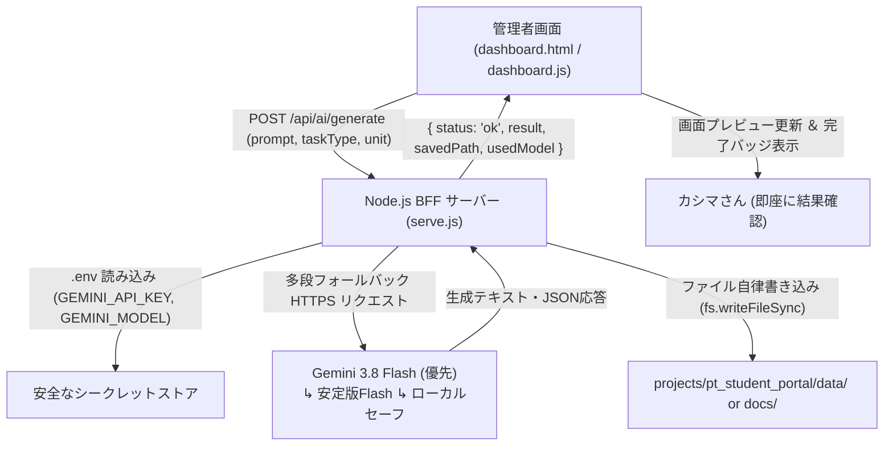

# ダッシュボード AI自動キック＆自律保存 アーキテクチャ設計書
**ファイル名**: `dashboard_ai_automation_spec.md`  
**対象プロジェクト**: `projects/pt_student_portal/`  
**管理者**: カシマさん専用

---

## 1. 概要と目的
当ダッシュボード（`http://localhost:3800/admin`）の「AIプロンプトトリガー」タブから、**ワンクリックで Gemini / TypeSafe AI をバックエンド（BFF）経由で直接キックし、生成されたクイズやnote記事・SNS台本をプロジェクト内の所定ディレクトリ（`projects/pt_student_portal/data/` または `projects/pt_student_portal/docs/`）へ自律保存する自動化パイプライン**を構築する。

---

## 2. コア要件とセキュリティ規律（Rule 9 遵守）
1. **APIキー完全隔離（BFF中継）**:
   - クライアント側（ブラウザのJSやHTML）に Gemini API キーを一切露出させない。
   - バックエンドのローカルサーバー（`serve.js`）が `projects/pt_student_portal/.env` からAPIキーおよび指定モデル（`gemini-3.8-flash` 等）を読み込み、サーバーサイドから Google AI Studio へ安全にリクエストする。
2. **コストゼロ（月額0円維持）**:
   - Google AI Studio の無料クォータを使用。
3. **自律保存（ローカルファイル直接書き込み）**:
   - 生成結果をダッシュボードの画面上にプレビュー表示するだけでなく、`projects/pt_student_portal/data/generated_quizzes.json` や `projects/pt_student_portal/docs/notes/*.md` へ即時保存する。
4. **多段カスケードフォールバック保証**:
   - `gemini-3.8-flash` を優先起動し、アップデートや混雑（404/429/503）発生時は下位/安定版モデルへ即座に自動フェイルオーバー。APIキー未設定時でもシステムがクラッシュせずローカルセーフモードへ移行する。

---

## 3. 全体アーキテクチャ図



---

## 4. API 仕様（BFF エンドポイント）

### `POST /api/ai/generate`

#### リクエストボディ (JSON)
```json
{
  "taskType": "note" | "sns_carousel" | "quiz" | "metaphor",
  "unit": "生理学 - 静止膜電位と活動電位の発生機序",
  "customPrompt": "追加の指示や重点（任意）"
}
```

#### レスポンス (JSON)
```json
{
  "status": "success",
  "taskType": "note",
  "unit": "生理学 - 静止膜電位と活動電位の発生機序",
  "content": "生成されたMarkdownまたはJSON文字列",
  "savedFile": "projects/pt_student_portal/docs/generated_note_20261023.md",
  "timestamp": "2026-10-23T11:05:00Z"
}
```

---

## 5. 実装ロードマップ（5ステップ）

| ステップ | 内容 | 担当ファイル |
| :--- | :--- | :--- |
| **Step 1** | `POST /api/ai/generate` ルーティング ＆ Gemini API 呼び出しロジックの追加 | `serve.js` |
| **Step 2** | `projects/pt_student_portal/.env` 読み込み機能の実装（ゼロ依存） | `serve.js`, `.env` |
| **Step 3** | 「AIプロンプトトリガー」UIに実行入力・「🚀 自動生成＆保存」ボタン・進捗バッジを追加 | `dashboard.html`, `dashboard.css` |
| **Step 4** | Fetch API呼び出し、ローディングスピナー、自律保存完了通知の追加 | `dashboard.js` |
| **Step 5** | ポータルサーバー実機での結合テスト・実ファイル出力検証 | ブラウザ ＆ Node.js |

---

## 6. マルチモデル・カスケードフォールバック機構（メンテナンス性・可用性設計）

```
[リクエスト受信]
      ↓
[1. 優先モデル (GEMINI_MODEL / gemini-3.8-flash)] ──(成功)──> [自律保存 ＆ 完了]
      ↓ (404/429/503/モデル廃止等で失敗)
[2. 次世代候補 (gemini-2.5-flash / gemini-2.0-flash)] ──(成功)──> [自律保存 ＆ 完了]
      ↓ (失敗)
[3. 安定版候補 (gemini-1.5-flash / gemini-1.5-pro)] ──(成功)──> [自律保存 ＆ 完了]
      ↓ (失敗)
[4. Google AI Studio 動的モデル探索 (/v1beta/models)] ──(成功)──> [自律保存 ＆ 完了]
      ↓ (全オンラインAPI不能 / オフライン / キー未設定)
[5. ローカルセーフモード (高品質テンプレート生成エンジン)] ──(完了)──> [ローカル書き込み ＆ 継続運用]
```

### なぜカスケードフォールバックが不可欠か
1. **API世代交代・モデル名変更への無停止適応**:
   - Google AI Studio のモデルは世代ごとに名称やエンドポイントが更新・移行されます。特定バージョンにハードコードすると、モデル廃止時に突然サービス全体がクラッシュします。
2. **クォータ・混雑制限（Rate Limit 429 / 503）の自動回避**:
   - 特定の最新Flashモデルでレートリミットに達した場合でも、即座に予備のFlashモデルへフォールバックして処理を継続できます。
3. **オフライン/未設定時の開発体験保証**:
   - APIキーがない状態やネットワーク切断時でもローカルセーフモードが発火し、ファイル生成・ダッシュボード連携の挙動が壊れません。

